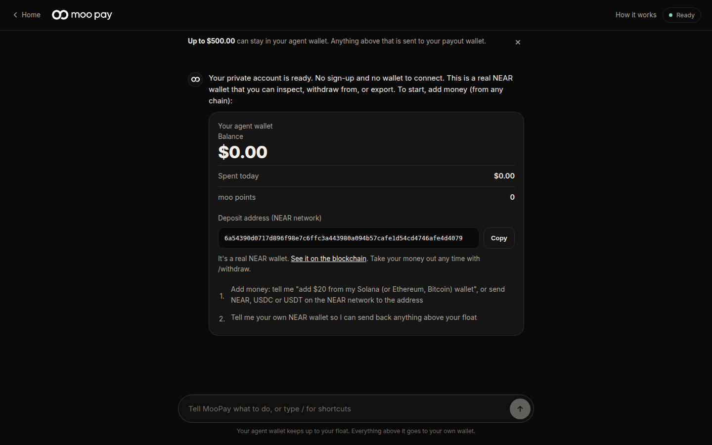
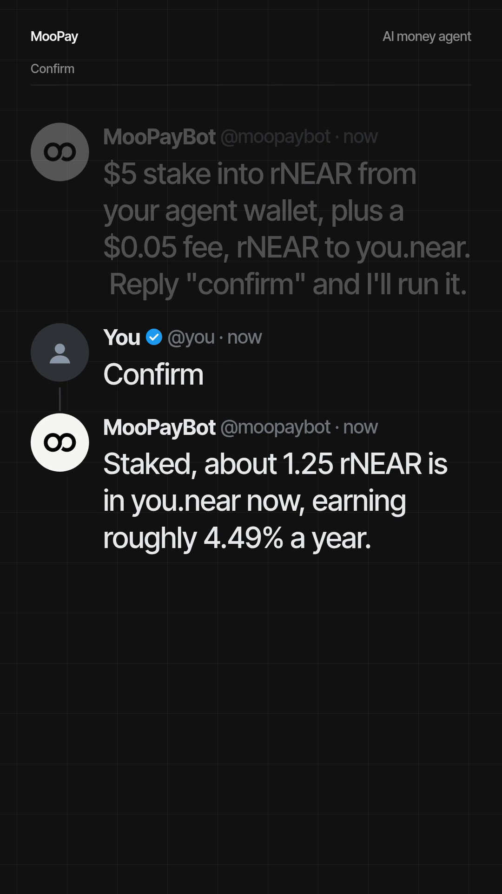

# MooPay

An AI money agent. Say who to pay and how much, in plain text. MooPay sends it to Bitcoin, Solana, Ethereum or NEAR wallets, splits it across people, schedules it, stakes it into rNEAR, or sends it privately. You can also reach it from X by mentioning the bot.

| | |
| --- | --- |
| Live demo | `LIVE_DEMO_URL` |
| Demo video (X post) | `X_DEMO_POST_URL` |
| Documentation | `/docs` on the running site (source in [`docs/`](docs/)) |
| Security policy | [SECURITY.md](SECURITY.md) |

Hackathon tracks: Agent Economy, Real-World Money, AI Security & Defense, Privacy & Private AI.

Status: experimental and unaudited. Read [Trust boundaries](#trust-boundaries) before putting money in.

## Problem

Paying someone on another chain today means picking a bridge, holding gas on a chain you do not use, and pasting addresses between three apps. Giving an AI agent the ability to do this for you is worse: the usual answer is to hand it a private key or a card, and then hope the prompt never gets talked into emptying the wallet.

## What MooPay does about it

- **One request, any chain.** The agent works out amount, chain and receiver from a sentence. Same-chain payments go direct. Cross-chain payments are quoted and delivered through [NEAR Intents (1Click)](https://near-intents.org), so you never bridge by hand.
- **No sign-up.** The browser holds a random recovery code. Only its hash is stored server-side.
- **The AI does not hold the rules.** Limits, approvals and allow-lists are plain TypeScript in [`src/agent/policy.ts`](src/agent/policy.ts), run before any money moves. The model only picks a tool.
- **Two ways to pay.** A small pre-funded agent wallet for fast, rule-bound payments, or your own wallet signing in a pay window when you do not want to deposit anything.
- **Outside agents get a leash.** Third-party AI agents use scoped `mpk_` keys with per-payment, daily and total budgets, an allow-list and an expiry.

## Capabilities

Each row names where it lives in the code.

| Capability | What it does | Code |
| --- | --- | --- |
| Cross-chain send | Pay a BTC, SOL, ETH or NEAR address in any asset 1Click supports. Direct transfer when both sides are on the same chain. | `src/agent/ops.ts`, `src/agent/intents/oneclick.ts`, `src/agent/chains/` |
| Add money from any chain | Fund the agent wallet from another chain and coin through a 1Click deposit. | `fund_wallet` in `src/ai/tools.ts`, `src/web/src/fund.ts` |
| Pay from your own wallet | No deposit. Opens a pay window (`/p/<id>`) and you sign with NEAR, Solana or EVM wallets. | `src/web/src/pay-logic.ts`, `src/server/routes/pay.ts` |
| Private claim | A link only the wallet you name can open, by signing with it. Expires after 24 hours and refunds you. NEAR, Solana and EVM; no Bitcoin. | `src/agent/claims.ts`, `src/server/routes/claims.ts`, `src/web/src/claim.ts` |
| Group payout | Several receivers, chains and assets in one request. `group_claim` makes one link where each wallet opens only its own share. | `group_payout`, `group_claim` in `src/ai/tools.ts` |
| Scheduled payments | Repeat a payment daily, weekly or monthly. Every run goes through the same rules. Needs money in the agent wallet, since nobody is there to sign. | `schedule_payment`, `cancel_schedule` |
| Private send (beta) | Routes USDC to a NEAR wallet through [OutLayer](https://outlayer.ai)'s private balance, so the chain does not link the payer's wallet to the receiver. Off unless `MOOPAY_PRIVATE_ROUTE=1`. | `src/agent/outlayer.ts` |
| Privacy chat | With a NEAR AI key the model runs inside sealed enclaves on NEAR AI Cloud. Chat history is opt-in (`/history`) and expires (30 days default). | `src/ai/cloud/nearai.ts`, `src/ai/providers/` |
| Stake rNEAR | Stakes NEAR with Rhea Finance and sends the rNEAR to your payout wallet. Unstake and withdraw open a window you sign. | `src/agent/rhea.ts`, `stake_rnear` and related tools |
| X agent | Mention the bot on X to send, split, stake or check a payment. Replies show only the start and end of addresses. Confirmation is a second post. Off unless the X keys are set. | `src/server/x.ts` |
| Agent keys and API | `mpk_` bearer keys for outside agents: `POST /agent/api/delegate/send`, `/claim`, `GET /agent/api/delegate/me`. | `src/server/routes/agent.ts`, `src/agent/policy.ts` |
| MCP connector | Five tools over HTTP or stdio for any MCP client: `route_cross_chain_intent`, `mint_private_claim_deposit`, `check_payment`, `check_claim`, `list_supported_assets`. | `src/ai/mcp/` |
| Moo points | 10 points per finished payment above $10, once each. | `earnPoints` in `src/agent/policy.ts` |

## Architecture

```
 chat / X mention / agent key (mpk_) / MCP client
                     |
                     v
            +-----------------+       tool call, not free text
            |  AI chat loop   |------------------------------+
            |  src/ai/loop.ts |                              |
            +-----------------+                              v
                                             +---------------------------------+
   server and AI reach wallets               |  Gateway  src/agent/index.ts    |
   only through this one door  ------------> |  ops.ts  (send, claim, stake)   |
                                             +---------------------------------+
                                                            |
                                           +----------------+----------------+
                                           v                                 |
                                  +------------------+                       |
                                  | Policy engine    |  deny -> stop         |
                                  | policy.ts        |  ask  -> confirm card |
                                  +------------------+  auto -> continue     |
                                           | auto                            |
                         +-----------------+------------------+              |
                         v                                    v              |
               same chain: direct transfer        cross chain: 1Click quote  |
               (NEAR, SOL, EVM drivers)           -> deposit address         |
                         |                                    |              |
                         +------------------+-----------------+              |
                                            v                                |
                                  +--------------------+                     |
                                  | Worker             |<--------------------+
                                  | worker.ts          |  polls status until
                                  +--------------------+  a final state
                                            |
                                            v
                         chat message / X reply / agent API result
```

**Rule:** `src/server` and `src/ai` reach wallets and chains only through `src/agent/index.ts`, and `src/agent` never imports `src/ai`. This keeps the model on one side of the policy engine.

### State and tracking

- State is JSON on one volume, in four files: users, claims, agent-wallet seeds and stats. Writes go to a temp file, fsync, then rename. With `SEED_KEY` set, files are encrypted at rest with XChaCha20-Poly1305 (`src/storage/encryption.ts`).
- One record per anonymous user (`src/agent/store.ts`): rules, known recipients, spend today, payments, schedules, agent keys, points. Request bodies are validated with Zod before reaching the service.
- Every payment carries a status. The worker (`src/agent/worker.ts`) polls it until it reaches a final one: `DELIVERED`, `CLAIMED`, `STAKED`, `REFUNDED` or `FAILED`, with `WAITING_FOR_FEE` as a holding state for stakes. It then writes the result into the chat.
- A background sweep runs every 10 minutes to close expired claims (`src/index.ts`).
- Claims bind to a recipient, chain, asset and amount with a SHA-256 commitment and a nullifier hash (`src/agent/crypto.ts`), so a claim opens once and only for the named wallet.

Details: [`docs/developers/overview/architecture.md`](docs/developers/overview/architecture.md) and [`docs/developers/inside-the-code/payment-flow.md`](docs/developers/inside-the-code/payment-flow.md).

## Security model

### Two wallets

| | Agent wallet | Your own wallet |
| --- | --- | --- |
| What it is | A NEAR implicit account made for you. The key is derived from a seed kept on the server. | Your NEAR, Solana or EVM wallet. |
| Who signs | The server, inside your rules. | You, in a pop-up pay window, every time. |
| Good for | Frequent, small, autonomous payments: schedules, X, outside agents. | Larger or occasional payments. Nothing is deposited. |
| Limit | Float cap (default $500). Anything above it is swept to your payout wallet. | Whatever your wallet holds. |
| Trust | The operator can technically move what is inside. Keep it small. | MooPay never holds the money. |

When the agent wallet cannot cover a payment, or you ask to pay from your wallet, the agent opens the pay window instead of failing.

### Policy and guardrails

Defaults (`DEFAULT_RULES` in `src/agent/store.ts`): float $500, daily cap $50, new-recipient limit $10, auto-approve up to $25. Enforced in `decide()` before money moves:

1. Amount must be above zero, otherwise deny.
2. Today's spend plus this payment over the daily cap: deny.
3. Unknown recipient above the new-recipient limit: ask.
4. Amount above the auto-approve limit: ask.
5. Otherwise: auto.

Other controls:

- **Loosening needs a human.** `rulesNeedApproval()` requires approval to raise a limit, allow more chains or assets, or change the payout wallet. Tightening does not.
- **Payout wallet hold.** A new payout wallet takes effect 24 hours after approval, so brief access cannot redirect a sweep.
- **Agent key leash.** `agentDeny()` checks revoked, expired, chain, asset, recipient, per-payment, daily and total budget. Keys can also be IP-restricted.
- **Freeze.** An account can be frozen; nothing leaves and no rule changes until `/unfreeze` with the recovery code.
- **Recovery code.** The browser keeps a random code; the server stores its hash. Exporting a wallet key, resetting the code and similar actions need the master code, not a session token.
- **Web hardening.** Nonce CSP and `X-Frame-Options: DENY` on agent pages, HSTS over https, per-IP rate limits and daily AI message caps (`src/server/middleware/security.ts`). The CSP on the wallet pages is report-only until checked against real wallet flows.
- **X specifics.** Payments need a separate confirm post; pasting the request again does not count. Addresses are shortened in replies. Service fee: 2% on X and 1% in the MooPay chat, on sends, claims and stakes paid from the agent wallet. It is taken by the worker after the payment lands (`takeFees` in `src/agent/ops.ts`), and only when `MOOPAY_FEE_ACCOUNT` is set.

### Trust boundaries

This is experimental and unaudited. What you are trusting:

- **The operator can use agent-wallet and claim-account funds.** Both keys derive from server seeds. This is the main trade-off for fast autonomous payments. It is why the float is capped and the sweep exists. It is not non-custodial.
- **Claims are not zero-knowledge.** The claim account's key is held by the server.
- **The AI provider sees chat unless enclave mode is on.** Use a NEAR AI key for sealed-enclave inference. If both keys are set, NEAR AI is used.
- **Private send hides less than it sounds.** The chain does not link the payer's wallet to the receiver, but receiver and amount are public, OutLayer and the solvers can see the payment, and timing can still correlate deposit and payout. OutLayer's own docs say its governance currently runs on single keys. Only USDC to a NEAR wallet has run against the real service; other routes are code-complete but off, after payouts to Solana failed three times in live tests.
- **Single machine.** State lives on one volume. Back up `SEED_KEY` separately; without it the wallets cannot be recovered. `scripts/backup.mjs` makes encrypted backups.
- **Not covered by tests:** real wallet signatures, mainnet payments and staking with real funds, and the report-only CSP. Try small real payments before trusting a change.

## Media

Screenshots and the demo video go here. Replace the placeholders with files you add under `docs/media/`.


*The chat: a plain sentence becomes a confirm card with receiver, amount and fee.*


*A send from the agent wallet to a Solana address, followed to delivery.*


*The same request from X, with the bot's quote and the confirm post.*

[Watch the full demo video](X_DEMO_POST_URL)

Short clips already in the repository: `moopay-landing-demo.mp4`, `moopay-stake-x.mp4`, `moopay-reel-1.mp4`, `moopay-reel-2.mp4`, `moopay-stake-recut.mp4`.

## Run it locally

Requires Node 22 or newer.

```bash
git clone https://github.com/UnclePhil1/moopay.git
cd moopay
npm install
cp .env.example .env
```

Edit `.env`:

- `SEED_KEY`: generate with `openssl rand -hex 32`. Without it, state and seed files are stored in plain text and a warning is logged.
- One AI key, `NEAR_AI_API_KEY` or `ANTHROPIC_API_KEY`. The chat is off without one.
- `WALLETCONNECT_PROJECT_ID` (free, from dashboard.reown.com) for phone wallets in the pay window.

```bash
npm run build     # tsc, wallet bundles (esbuild), docs
npm start         # http://127.0.0.1:3333
```

The app defaults to NEAR mainnet. Use small amounts. Everything else in `.env.example` is optional and commented.

| Script | What it does |
| --- | --- |
| `npm test` | 127 unit tests with fake NEAR and fake 1Click. No network, no money. |
| `npm run smoke` | MCP over stdio against a local fake 1Click. |
| `npm run smoke:http` | MCP over HTTP against a local fake 1Click. |
| `npm run testnet` | End-to-end on NEAR testnet (`scripts/testnet-e2e.ts`). |
| `npm run live-check` | Checks the live 1Click API. |
| `npm run x:authorize` | One-time OAuth 1.0a helper to get the X access token. |

### Judge verification checklist

No keys or funds are needed for 1 to 3.

1. **Build and unit tests.** `npm run build && npm test`. Expect `pass 127`, `fail 0`. The tests cover policy, claims, crypto, the gateway, staking, the X agent and the web security headers.
2. **MCP over stdio and HTTP.** `npm run smoke && npm run smoke:http`. Expect `SMOKE OK` and `HTTP SMOKE OK`. This exercises cross-chain routing, claim minting, bad-recipient rejection and wrong-token rejection.
3. **Rules cannot be argued around.** Read `decide()` in `src/agent/policy.ts` and `tests/unit/agent.test.ts`. The tests check denial, ask and auto paths without a model in the loop.
4. **Chat (needs an AI key).** Run `npm start`, open `http://127.0.0.1:3333/agent`, and try:
   - `What can you do?`
   - `Send $1 to alice.near` (shows a confirm card, nothing moves until you confirm or the agent wallet is funded)
   - `Set my daily limit to $5`, then `Send $6 to alice.near` (denied by the cap)
   - `Create an agent key called test, $2 per payment, 24 hours` (shows an `mpk_` key once), then `GET /agent/api/delegate/me` with `Authorization: Bearer mpk_...`
5. **Claims and staking (small mainnet amounts).** `Create a private claim of $1 for <your wallet address>`; `Stake $1 into rNEAR` after setting a payout wallet.

## Repository structure

```
config/                  environment schema (Zod), paths
src/index.ts             entry: storage -> gateway -> AI -> HTTP server -> worker
src/agent/
  index.ts               the gateway: only door to wallets and chains
  policy.ts              spending rules, approvals, agent-key limits, points
  ops.ts                 send, claim, group, schedule, stake, withdraw
  service.ts             pay intents, quotes, verification
  worker.ts              follows payments to a final state
  store.ts               users, rules, payments, keys
  claims.ts, crypto.ts   claim accounts, commitments, nullifiers
  outlayer.ts            private route (beta)
  rhea.ts                rNEAR staking
  intents/oneclick.ts    NEAR Intents 1Click client
  chains/                NEAR, Solana, EVM, Chain Signatures drivers
src/ai/
  loop.ts, tools.ts      chat loop and the tool list the model may call
  providers/, cloud/     Anthropic and NEAR AI Cloud (sealed enclaves)
  mcp/                   MCP connector, HTTP and stdio
src/server/
  router.ts, routes/     pages, chat and account API, agent-key API, pay, claims
  middleware/            headers, CSP, rate limits, body parsing
  x.ts                   the X agent
src/storage/             encrypted atomic JSON files, schemas, ledger, seeds
src/stat/                password-protected team numbers page (/stat)
src/web/                 public pages and the wallet/pay/claim code bundled by build.js
tests/                   unit tests and fakes
scripts/                 smoke, testnet, live-check, backup, docs build, X authorize
docs/                    user and developer docs, built into the site
guides/                  reference notes on NEAR Intents, 1Click and prior privacy designs
```

Deploy: `fly deploy` builds the Dockerfile and runs `node dist/src/index.js`. `.github/workflows/fly.yml` deploys on every push to `main`.

## Dependencies

`@anthropic-ai/sdk`, `@modelcontextprotocol/sdk`, `near-api-js`, `@near-wallet-selector/*`, `@solana/web3.js`, `@reown/appkit`, `@noble/*` (ciphers, curves, hashes), `zod`. Build tooling: `typescript`, `esbuild`, `tsx`. There is no web framework; the server is plain Node HTTP.
